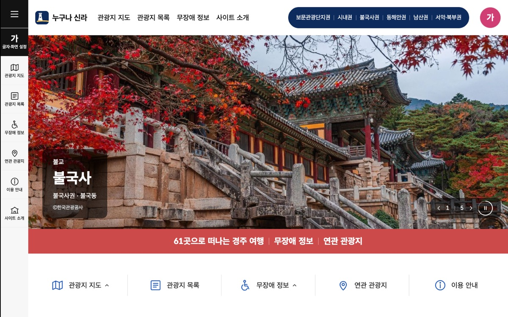
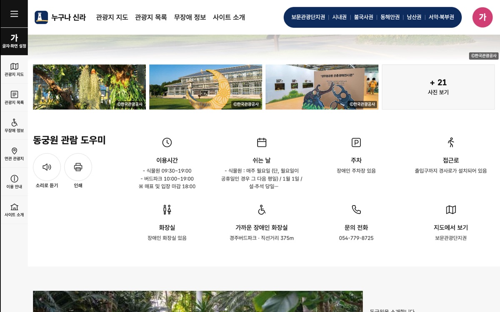

# 누구나 신라

경주 관광지 61곳의 위치와 무장애 정보를 한곳에 모은 안내 누리집



| 기간 | 대회 | 결과 | 배포 |
|---|---|---|---|
| 2026.9.14 ~ 30 | 한국관광 데이터랩 활용 경진대회 | 참가 | https://sillaforall.vercel.app |

## 문제의식

- 한국관광 데이터랩 자료로 경주 관광지별 방문자 세대 구성을 2025년과 2026년으로 비교
- 60대 이상 방문자 비중이 오른 관광지 다수
- 노년층이 많이 찾는 관광지일수록 한국관광공사 무장애 여행 정보 미등록 다수
- 휠체어·유모차 접근, 장애인 화장실, 주차장 정보를 알기 어려운 곳이 노년층 방문지에 집중

## 해결 방법

- 관광지마다 흩어진 무장애 정보를 한 화면에 수집
- 빈 칸은 공식 자료와 사진으로 보완, 칸마다 자료 이름 표기
- 읽는 사람이 노년층인 만큼 글자 크기와 화면 대비를 바꿀 수 있는 공공 누리집 틀 적용

## 주요 기능

- 권역별 지도: 보문, 시내, 불국사, 동해안, 남산, 서악·북부


- 관광지 상세: 관람 도우미(이용시간, 쉬는 날, 주차, 접근로, 화장실), 사진, 오시는 길



- 무장애 정보: 접근로, 주차, 화장실, 출입구 같은 항목, 정보가 있는 곳과 없는 곳 구분 보기, 보는 법과 항목별 요약표


- 글자 크기 조절, 선명한 화면 모드, 소리로 듣기

## 만들며 부딪힌 문제

- 관광공사 사진의 저장 금지 조건
  - 원인: 사진 자료 이용 조건의 캐싱 금지
  - 해결: 사이트에 두지 않고 원 주소로 호출, 사진 서버가 막히면 칸 숨김
- 카카오 지도 미표시
  - 원인: 등록한 주소에서만 응답하는 지도 키
  - 해결: 카카오 실패 시 오픈스트리트맵, 그림 지도 순서로 대체
- 파이어폭스에서 소리로 듣기를 멈추면 재생 불가
  - 원인: 멈춤 호출 뒤 음성 상태가 풀리지 않는 브라우저 동작
  - 해결: 파이어폭스만 문장 단위로 넘기는 방식으로 변경

## 돌아본 점

- 잘된 것: 빈 칸을 다른 공공 자료로 채우고 출처 표기, 브라우저별 점검
- 잘못된 것: 실제 휴대전화와 어르신 사용 시험 없이 흉내 화면으로만 확인
- 다시 한다면: 어르신 시험 사용부터 진행, 주말 배차처럼 자료에 없는 정보의 보완 경로 확보

## 기술

- Next.js 16, React 19, TypeScript, 카카오 지도
- 화면 틀은 정부 디지털 서비스 디자인 시스템(KRDS), 뒤에 만든 [해치동행](https://github.com/noru-0731/haechi-donghaeng)에서 재사용
- AI 도구: 자료 분석 스크립트와 누리집 구현을 AI 코딩 도구(Claude Code)로 진행

## 자료 출처 · 실행

- 한국관광 데이터랩(관광지별 세대 구성)
- 한국관광공사 TourAPI(관광지 목록, 무장애 정보)
- 사진: 경주시정뉴스(공공누리 제1유형), 위키미디어 공용(CC BY-SA). 출처는 누리집의 자료 출처 쪽에 표기

```bash
npm install
npm run dev
```

지도 표시에는 `.env.local`의 `NEXT_PUBLIC_KAKAO_MAP_KEY`(카카오 JavaScript 키) 필요
